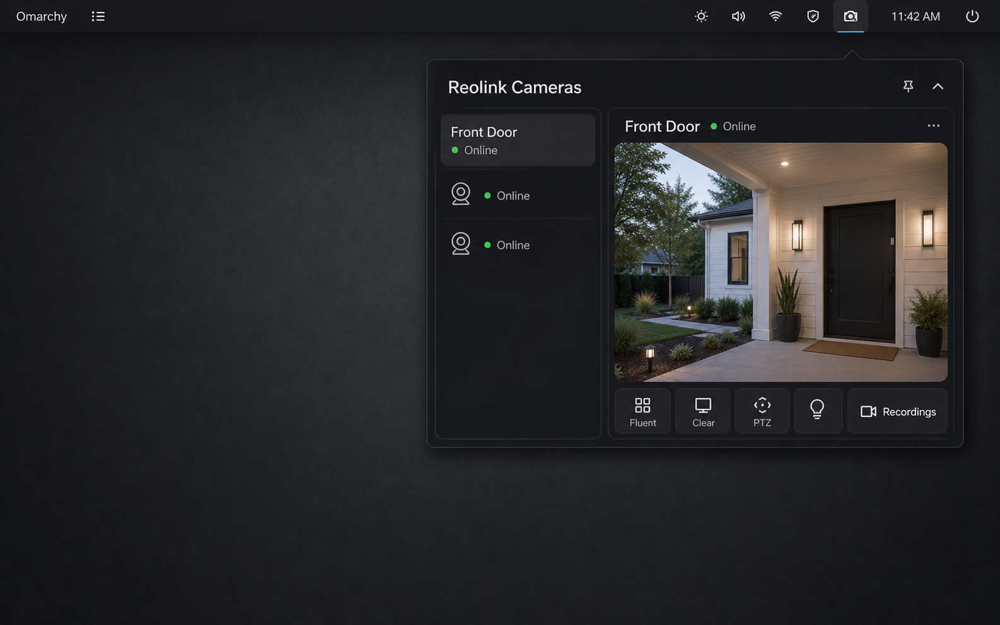

# Reolink Cameras for Omarchy

A native, local-first Omarchy bar plugin for quickly checking Reolink cameras,
NVRs, and Home Hubs on your LAN.



_Interface concept; a sanitized live-device screenshot will replace it after
the hardware-validation matrix is complete._

The panel uses private local JPEG snapshots. Fluent and Clear video open in
stock `mpv`; no media framework or camera daemon is added to Omarchy.

> **Development status:** `0.1.2` is an experimental hardware-validation build,
> not a tagged V1 release. The fixture inventory, helper, QML, live-shell, and
> secret-leak gates pass on Omarchy 4.0.1.
> Real Reolink hardware coverage is still being recorded; see
> [Hardware testing](docs/hardware-testing.md) before relying on a specific
> model or physical control.

## Stock Omarchy first

Runtime dependencies are already part of a stock Omarchy install:

- Quickshell/QML/JavaScript;
- Bash, curl, and jq;
- Secret Service through `secret-tool` and GNOME Keyring;
- mpv and socat;
- `omarchy notification send`.

There is no Python, Node/npm, MQTT broker, go2rtc, Docker container, Qt
Multimedia package, Home Assistant dependency, new network listener, user
systemd service, or package-install step.

## Install

```bash
omarchy plugin add https://github.com/rodrix2000/omarchy-reolink-cameras --enable
```

The plugin starts with no configured cameras. Open the camera icon, choose
**Add**, and enter local Reolink device credentials. Reolink cloud credentials
are not used.

Prefer:

1. verified HTTPS;
2. explicitly selected self-signed HTTPS on a trusted LAN;
3. HTTP only as an explicit LAN fallback.

A dedicated least-privilege local Reolink user is recommended where the
device supports one.

### Reolink camera settings

Before adding a powered camera, NVR, or Home Hub, open its Reolink **Device
Settings**, select the device-model card, then open **Advanced Network
Settings → Server Settings**. The exact menu wording can vary by firmware.

- Enable **HTTPS** on port `443` for control, discovery, and snapshots.
- Enable **RTSP** on port `554` for Fluent and Clear video playback.
- The existing Basic Service port `9000` may remain enabled for Reolink's own
  applications, but this plugin does not use it.
- HTTP, RTMP, and ONVIF are not required by this plugin. Leave unused services
  disabled unless another trusted local integration needs them.

Use a bare LAN address rather than a URL. A typical powered Reolink setup is:

| Plugin field | Typical value |
| --- | --- |
| Host or IP | `192.168.1.54` |
| Transport | `HTTPS` |
| Port | `443` |
| TLS | `Allow self-signed · trusted LAN only` when the camera's local certificate cannot be verified |
| Username | `admin` (lowercase default device administrator) |
| Password | The local device password—not a Reolink account/cloud password |
| Display name | Any local label, such as `Front Door` |

`Share Device` links and Reolink account email credentials are not local
device credentials and cannot be used here. Models without **User Management**
may expose only the built-in `admin` account. Battery-family devices generally
need a compatible Home Hub; configure the Hub address and local credentials in
that topology.

See Reolink's official
[port configuration guide](https://support.reolink.com/articles/900000621783-How-to-Configure-Reolink-Ports-Settings/)
for current app menus and model-specific availability.

### Add troubleshooting

| Message | Meaning and action |
| --- | --- |
| `Camera returned HTTP status 302.` | HTTP port `80` redirected to HTTPS. Select HTTPS, port `443`, and the appropriate TLS mode. |
| `Camera TLS verification or negotiation failed.` | Confirm HTTPS is enabled. On a trusted private LAN, explicitly select the self-signed TLS option. |
| `Camera rejected the local account credentials.` | Use the local device username/password. The default administrator is usually lowercase `admin`; do not use Reolink account email credentials. |
| `Camera returned HTTP status 401.` or `403.` | The endpoint rejected authorization. Recheck the local account and device-access mode. |
| `Camera network request failed.` | Confirm the bare IP address, enabled HTTPS port, same-LAN reachability, and local firewall rules. |

## What is implemented

- `service` + `bar-widget` inside the existing `omarchy-shell`;
- multiple isolated hosts with per-host sessions, request queues, and backoff;
- Secret Service password storage and private non-secret configuration;
- host/channel/capability discovery;
- snapshot-first panel with a private bounded cache;
- Fluent/sub and Clear/main playback through hardened mpv IPC;
- batched per-host event polling, rising edges, cooldown, unseen badge, and
  safe UI-only notification clicks;
- capability-gated PTZ, presets, zoom, spotlight, and confirmed siren controls;
- bounded same-host recording search and playback path;
- in-plugin per-device forget and privacy reset.

Unsupported controls stay hidden. Snapshot, RTSP, recording, and event
failures degrade independently.

## Device boundary

Expected primary support:

- powered PoE and plug-in Wi-Fi cameras with CGI/RTSP enabled;
- Reolink NVRs;
- Reolink Home Hubs.

Battery cameras generally require a compatible Home Hub for third-party
protocol access. Standalone 4G/LTE models are not promised. Capability data and
verified command results—not model-name guesses—drive the UI.

Official protocol references:

- [CGI/RTSP/ONVIF compatibility](https://support.reolink.com/articles/900000617826-Which-Reolink-Products-Support-CGI-RTSP-ONVIF/)
- [RTSP channel and stream format](https://support.reolink.com/articles/900000630706-Introduction-to-RTSP/)
- [JPEG snapshots](https://support.reolink.com/articles/360007011233-How-to-Capture-Live-JPEG-Image-of-Reolink-Cameras-via-Web-Browsers/)

## Security model

- Passwords are stored only in Secret Service.
- Session tokens remain in service/helper memory.
- Passwords, tokens, and credential-bearing URLs never enter process argv,
  environment variables, config, logs, notification payloads, or filenames.
- Curl receives secret request material through private inherited pipes.
- mpv starts without a media URL and receives it over a mode-restricted Unix
  socket under `$XDG_RUNTIME_DIR/omarchy-reolink`.
- A secret-free watchdog kills mpv and removes its per-run IPC directory even
  if Quickshell hard-kills the controller process during plugin teardown.
- mpv always uses `--no-config`, `--load-scripts=no`, and `--terminal=no`, so
  stock `mpv-mpris` and user scripts cannot inspect the Reolink URL.
- Verified HTTPS recording playback explicitly enables mpv certificate
  verification; disabling it requires the host's saved insecure-TLS choice.
- Requests have strict allowlists, timeouts, response caps, no redirects, and
  no proxy use.
- PTZ has release-to-stop plus an independent safety timer. Siren activation
  always requires confirmation.

See [SECURITY.md](SECURITY.md) and
[the security testing notes](docs/security-testing.md).

## Local validation

```bash
./scripts/check.sh
```

The full release gate includes:

```bash
omarchy plugin validate .
PATH="/usr/lib/qt6/bin:$PATH" \
  qmllint -I "$OMARCHY_PATH/shell" Service.qml BarWidget.qml Panel.qml
bash -n scripts/*
```

`scripts/check.sh` adds a stricter import-aware lint pass, a device-matrix logic
test, helper tests, keyring checks, deterministic headless player IPC checks,
real mpv isolation checks when a display is available, and security scans.

## Local data and removal

- Config: `${XDG_CONFIG_HOME:-~/.config}/omarchy-reolink/config.json`
- Snapshots: `${XDG_CACHE_HOME:-~/.cache}/omarchy-reolink/snapshots/`
- mpv IPC: `$XDG_RUNTIME_DIR/omarchy-reolink/`
- Passwords: Secret Service attributes `application=omarchy-reolink`,
  `host-id=<id>`, `kind=password`

Before removing the plugin, use **Forget all devices and local camera data**.
Ordinary Git plugin removal is not assumed to execute cleanup code.
If a keyring backend error interrupts a failed Add rollback, the plugin keeps
only the non-secret host ID and shows **Retry credential cleanup** until the
password is confirmed absent.
The cleanup ID is written before credential storage, so a shell reload during
Add remains recoverable without persisting the password itself.

## Contributing

Read [CONTRIBUTING.md](CONTRIBUTING.md). Hardware reports should identify the
topology, model/hardware revision, firmware, supported channel path, and which
capabilities were tested—never credentials, tokens, or media URLs.
